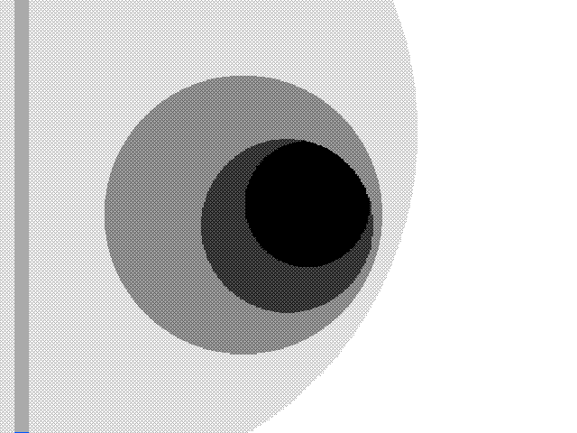

<!---

This file is used to generate your project datasheet. Please fill in the information below and delete any unused
sections.

You can also include images in this folder and reference them in the markdown. Each image must be less than
512 kb in size, and the combined size of all images must be less than 1 MB.
-->

## How it works

Pit Jumper is a VGA game, written in TL-Verilog in Makerchip. You parachute down an endless pit, viewed from
above (from your own perspective). The pit's walls are a never-ending series of circular openings, drawn in
perspective, that grow and lighten as you fall past them. The pit meanders; steer with the D-pad to stay
within it. Passing an opening outside its edge ends the game (the pit turns red). The depth meter on the left
counts the openings passed; each 512 is a level (blue, green, yellow, then magenta), and each level falls faster.

It draws a 640x480 picture at 60 Hz, one pixel per clock cycle (25.175 MHz), in 4 shades of gray, dithered
for 64 levels. The nearest 4 openings are drawn, 64 units apart in depth, each a circle of radius 512 units
centered on a sum of two triangle waves of its index. A pixel shows the wall of the nearest opening it is
outside of (or the black abyss beyond them all), shaded by that opening's depth.

To draw the circles without multipliers, it works in "ray space": the pixel at offset g from the center of the
screen sees, at depth z, the lateral position g * z / 32 (relative to you). Along a line, that is a running sum,
so each pixel needs just two comparisons per opening, with the line's span of the opening. During each line's
horizontal blanking, it computes each opening's span for the next line, using a table of square roots.

The game state changes once per frame. You crash if the pixel at the center of the screen is outside the
nearest opening as it passes.

## How to test

Connect a VGA monitor (through the Tiny VGA Pmod) and the Gamepad Pmod, then release reset. Steer with the D-pad
to keep the center of the screen within the openings. After a crash, press A or start to play again.

In VGA Playground, enable the gamepad and use the arrow keys, and the `a` or `t` (start) key to restart.

## External hardware

- [Tiny VGA Pmod](https://github.com/mole99/tiny-vga) on the outputs.
- [Gamepad Pmod](https://github.com/psychogenic/gamepad-pmod) on the inputs.
